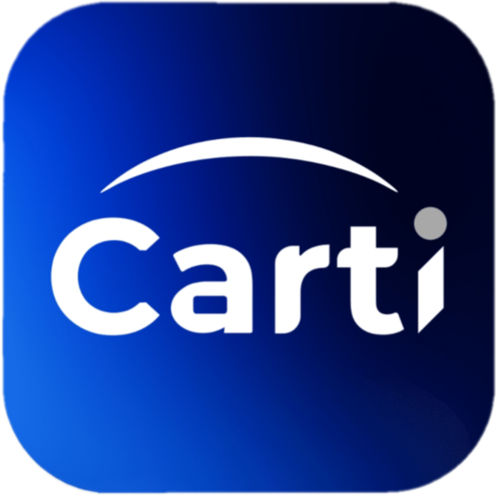

💳 Carti

Toutes vos cartes de fidélité au même endroit.

  

  **Bien plus qu'une carte de fidélité. Une nouvelle façon de découvrir, de partager et de gagner des récompenses.**

  💳 Portefeuille numérique · 📍 Découverte de commerces · 🎁 Récompenses

---

🌟 À propos de Carti

Carti est une plateforme numérique de fidélité conçue pour moderniser l'expérience traditionnelle des cartes de fidélité.

Elle réunit les clients et les commerçants au sein d'un même écosystème numérique, permettant aux utilisateurs de gérer leurs cartes de fidélité, de découvrir les commerces à proximité, de consulter des offres exclusives et de profiter de récompenses lors de leurs achats quotidiens.

Fini les portefeuilles remplis de cartes physiques ! Avec Carti, toutes les cartes de fidélité sont accessibles directement depuis un smartphone.

Notre objectif est de rendre les programmes de fidélité plus simples, plus intelligents et accessibles à tous.

---

📱 Fonctionnalités principales

Carti s'articule autour de quatre sections principales, chacune conçue pour offrir une expérience simple, moderne et intuitive.

💳 1. Wallet – Portefeuille numérique

Toutes vos cartes de fidélité dans un seul endroit.

Le Wallet est l'écran principal de Carti. Il permet aux utilisateurs de regrouper, organiser et consulter leurs cartes de fidélité numériques.

Les cartes sont présentées sous forme de cartes superposées (Stacked Cards), offrant une expérience visuelle moderne et interactive.

Fonctionnalités :

- 🪪 Ajouter et gérer des cartes de fidélité numériques.
- 🎨 Affichage interactif des cartes superposées.
- 📷 Scanner des QR codes.
- ⭐ Accumuler des points et des tampons.
- 🎁 Suivre les récompenses et les avantages.
- 👑 Accéder aux niveaux de fidélité et aux privilèges exclusifs.

📍 2. Map – Carte interactive

Découvrez les commerces autour de vous.

La section Map permet aux utilisateurs de découvrir les établissements partenaires et les commerces à proximité.

Fonctionnalités :

- 🗺️ Carte interactive des commerces partenaires.
- 📌 Localisation des établissements à proximité.
- 🏪 Découverte de restaurants, cafés, boutiques et autres commerces.
- 🎯 Identification des commerces proposant des programmes de fidélité.
- 🎉 Découverte des promotions et offres disponibles.

👥 3. Community – Communauté

Un espace pour découvrir, partager et interagir.

La section Community crée un environnement interactif permettant aux utilisateurs et aux entreprises de communiquer et de partager leurs actualités.

Fonctionnalités :

- 📝 Publier et découvrir des publications.
- ❤️ Aimer et commenter les publications.
- 💬 Participer aux discussions.
- 📢 Consulter les actualités des commerces.
- 🎉 Découvrir des offres exclusives.
- 🔔 Suivre les activités de la communauté.

👤 4. Profile – Profil utilisateur

Gérez votre compte et vos avantages en toute simplicité.

La section Profile permet aux utilisateurs de gérer leurs informations personnelles, leurs préférences et leurs paramètres.

Fonctionnalités :

- 🧑 Gestion des informations personnelles.
- 👑 Consultation du niveau de fidélité.
- 🎁 Consultation des récompenses et avantages.
- 🔔 Gestion des notifications.
- ⚙️ Paramètres du compte.
- 🛡️ Confidentialité et sécurité.
- 💬 Assistance et support.

---

🏪 Carti pour les commerçants

Carti ne s'adresse pas uniquement aux consommateurs. La plateforme ambitionne également de proposer aux commerçants une solution numérique pour gérer leurs programmes de fidélité et développer leur relation client.

Les entreprises pourront notamment :

- 🎨 Créer des cartes de fidélité numériques personnalisées.
- 📊 Gérer leurs programmes de fidélité.
- 📷 Utiliser des QR codes pour les interactions avec les clients.
- 🎁 Proposer des récompenses et des offres spéciales.
- 📢 Promouvoir leurs produits et services.
- 👥 Fidéliser leur clientèle.
- 📈 Améliorer la rétention et l'engagement des clients.

Carti a pour ambition de rendre la fidélisation numérique accessible aux commerces de toutes tailles.

---

🎯 Notre mission

Notre mission est de simplifier la fidélité et de créer un lien plus fort entre les consommateurs et les commerçants.

Nous pensons que la fidélité doit être simple, accessible et avantageuse.

En réunissant les cartes numériques, la découverte de commerces, les récompenses et une communauté interactive au sein d'une seule plateforme, Carti souhaite transformer la manière dont les consommateurs interagissent avec leurs commerces préférés.

---

🎨 Identité visuelle

Carti adopte une identité visuelle moderne, futuriste et inspirée de l'univers technologique.

Élément| Identité
🔵 Couleur principale| Bleu électrique
🌌 Couleur secondaire| Bleu nuit
⚪ Texte| Blanc
✨ Couleur d'accent| Or métallique
🖤 Interface| Dark Mode
💎 Style| Moderne et futuriste

---  

🛠️ Développement

Carti est actuellement en phase de conception et de préparation du développement.

L'identité visuelle, le logo et les concepts d'interface utilisateur (UI/UX) ont été définis.

Les prochaines étapes porteront notamment sur :

- 📱 Développement de l'application mobile.
- 🔐 Mise en place de l'authentification.
- 🗄️ Conception de la base de données.
- 💳 Gestion des cartes de fidélité numériques.
- 📷 Intégration du système de QR codes.
- 📍 Développement de la carte interactive.
- 👥 Mise en place de la communauté.
- 🏪 Développement des fonctionnalités destinées aux commerçants.

---

🚀 Vision à long terme

Notre ambition est de faire de Carti un écosystème numérique de fidélité capable de connecter les consommateurs et les commerces au quotidien.

Nous souhaitons dépasser le concept traditionnel de carte de fidélité pour proposer une plateforme complète, centralisée et évolutive.

Carti – Plus qu'une carte, un monde d'avantages.

---

  💙 Made with passion for a smarter loyalty experience.

